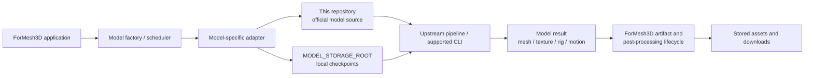

# ForMesh3D Third-Party Model Sources

This repository is the source-code collection used by [ForMesh3D](https://github.com/Silentzx2/ForMesh3D). It keeps the upstream model implementations in one separately versioned Git repository so the main application can pin a known source snapshot through the `backend/thirdparty` Git submodule.

It is a **source-code repository**, not a model-weight store, Python environment, inference server, or single unified library. Each model retains its own package layout, requirements, inference entry point, configuration, and upstream license.

## What lives here

The current tree groups model sources into 14 top-level directories. They cover 17 adapter/feature integrations in the main ForMesh3D repository; several integrations intentionally share one upstream source tree.

| Directory | Main purpose | Typical ForMesh3D use | Checkpoint location convention* |
|---|---|---|---|
| `ardy/` | Text-conditioned human-motion generation | ARDY motion generation | `ardy` |
| `FastMesh/` | Neural mesh retopology, including V1K and V4K variants | Retopology of an existing mesh | `FastMesh-V1K`, `FastMesh-V4K` |
| `Hi3D/` | SPARC3D-based geometry refinement | Experimental image-conditioned refinement of a supplied coarse mesh | `Hi3D` |
| `Hunyuan3D-2.1/` | Hunyuan3D 2.1 shape generation and PBR painting source | Shape and paint integrations sharing upstream source | `tencent/Hunyuan3D-2.1` |
| `hunyuan3d-2/` | Earlier Hunyuan3D 2 source | Legacy/mini model source integration | `tencent/Hunyuan3D-2mini` |
| `Paint3D/` | Coarse-to-fine UV texture diffusion for existing meshes | Text- or image-conditioned texture generation | `Paint3D` |
| `PartUV/` | Part-aware UV unwrapping and chart processing | UV unwrapping | `PartUV` |
| `Pixal3D/` | Camera-aware, pixel-aligned image-to-3D generation | Image-to-3D geometry and PBR attributes | `Pixal3D` |
| `Taobao3D/` | Taobao3D collection, including TaoFlowForge | Progressive native mesh generation | `Taobao3D/TaoFlowForge` |
| `TRELLIS/` | TRELLIS image-to-3D pipeline | Image-to-3D generation | `TRELLIS` |
| `TRELLIS.2/` | TRELLIS.2 cascaded image-to-3D and texturing source | Image-to-3D and mesh texturing | `TRELLIS.2` |
| `TripoSG/` | Single-image 3D generation | Image-to-3D geometry | `TripoSG` (plus its required background-removal weights) |
| `UniRig/` | Skeleton prediction and skinning | Character auto-rigging | `UniRig` |
| `Unique3D/` | Single-image 3D generation and refinement | Image-to-3D geometry | `Unique3D` |

`*` These are the main project's intended per-model keys beneath `MODEL_STORAGE_ROOT`, not a guarantee that every checkpoint has been downloaded or is loadable. The downloader and `backend/loader.py` in the main project define the actual configured paths.

## Intended integration architecture

The application keeps orchestration and persistence separate from upstream model implementation. This diagram describes the intended responsibility boundaries; it is not a claim that every adapter has passed runtime or quality validation.



Responsibilities are intentionally split:

- **This repository:** upstream source snapshots and the source-side files that belong to those projects.
- **ForMesh3D adapters:** the minimal bridge from the application's input/result contract to a model's real public inference API or supported CLI.
- **ForMesh3D loader/downloader:** checkpoint path resolution and downloads under the shared model-weight root. Checkpoints do not belong in this Git repository.
- **ForMesh3D scheduler and post-processing:** resource admission, worker lifecycle, immutable source assets, derivatives, QA, manifests, and downloads.

There is no shared import name or universal dependency set across these directories. A directory existing in this repository does not by itself make its Python package importable: follow that model's own packaging, requirements, CUDA/toolchain, and import instructions.

## Getting the source

### Clone the main application with all submodules

From a fresh checkout, the recommended route is:

```bash
git clone --recurse-submodules https://github.com/Silentzx2/ForMesh3D.git
cd ForMesh3D
git submodule status --recursive
```

The main project records an exact ThirdParty commit. Recursive cloning initializes this repository and any nested submodules declared by its model sources.

### Initialize or refresh submodules after a normal clone

```bash
git submodule update --init --recursive
```

To inspect the checked-out ThirdParty revision:

```bash
git -C backend/thirdparty rev-parse HEAD
git -C backend/thirdparty status --short
```

The expected revision is the gitlink recorded by the main repository's current commit. Do not independently advance this checkout and assume the application now uses that revision; update the main repository's gitlink as a separate, reviewed change.

## Using a model source

1. Identify the exact model integration and source directory from the main project's model manifest and adapter registry.
2. Read that directory's upstream `README.md`, license/notice files, packaging metadata, and any nested `.gitmodules`.
3. Install only the dependencies and compiled extensions required by that model, using the upstream instructions and the main project's supported environment.
4. Download its checkpoint files to the configured `MODEL_STORAGE_ROOT/<model-key>` directory using the main project's downloader.
5. Verify the adapter's import root, loader arguments, input types, inference signature, return type, and export path against the checked-out source revision.
6. Run the model-specific CPU contract tests where available, then a real checkpoint-load and inference smoke test on supported hardware. A successful Python import or directory listing is not an inference validation.

Useful inspection commands:

```bash
# List all tracked model-source directories
find backend/thirdparty -mindepth 1 -maxdepth 1 -type d -print

# Find each project's own setup instructions
find backend/thirdparty -mindepth 2 -maxdepth 3 \\
  \( -name README.md -o -name pyproject.toml -o -name setup.py -o -name requirements.txt \\) -print

# Inspect nested upstream dependencies
git -C backend/thirdparty submodule status --recursive
```

Do not install every model's requirements into one environment blindly. Packages may pin conflicting versions of PyTorch, CUDA extensions, Diffusers, Transformers, or rendering libraries.

## Updating a model source

Treat this repository as a pinned source snapshot. For an upstream refresh:

1. Identify the official upstream repository and target revision for the specific model.
2. Compare the existing snapshot and local integration changes before replacing or merging files.
3. Keep unrelated model directories untouched.
4. Run source-level checks and the applicable model-specific tests.
5. Commit the source change here first.
6. Update `backend/thirdparty` in ForMesh3D to point at that exact new commit, then commit the main repository change.
7. Verify that the main repository's gitlink SHA equals this repository's intended commit.

Do not use an unreviewed `git submodule update --remote` as a substitute for checking upstream compatibility. Main-project source changes and the submodule pointer must be reviewed together.

## Directory and license policy

The model directories retain their upstream README, LICENSE, NOTICE, attribution, and other project-owned files where supplied. **There is no single license for this entire collection.** Terms differ by upstream project and can also differ between source code, pretrained checkpoints, datasets, and hosted demos. Read the license files inside the exact model directory and verify checkpoint terms before redistribution or commercial use.

This repository intentionally does not store large model checkpoints, generated outputs, user uploads, API secrets, or environment files. Keep these in local or separately managed storage.

## Integration and validation status

The presence of a model source here means its code is vendored in this collection; it does not certify that the main project's current adapter is correctly importing it, that all dependencies are installed, that weights are complete, or that inference produces valid output. The main ForMesh3D repository tracks adapter and runtime status in its documentation and tests. GPU-backed inference and output-quality validation must be reported separately from source inspection and CPU-only CI.

## Upstream project documentation

Each directory's own README and license files are authoritative for that project's setup and terms. Start with the directory table above, then continue with the upstream-specific documentation rather than applying a generic installation recipe to all models.
