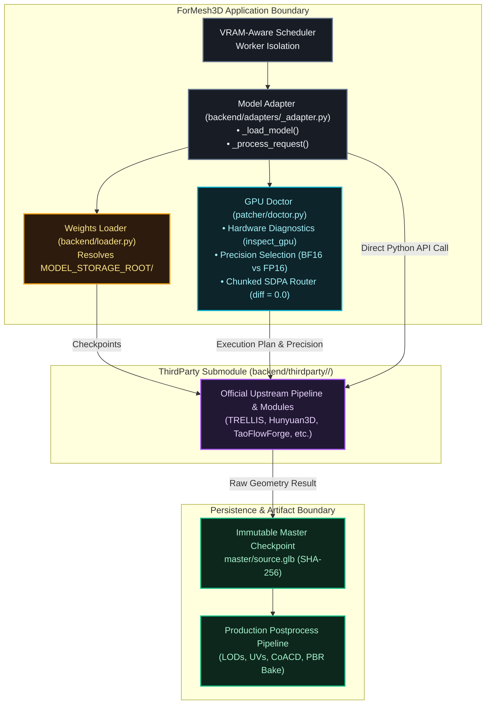

# ForMesh3D Third-Party Model Sources

This repository is the upstream source-code collection vendored as a Git submodule for [ForMesh3D](https://github.com/Silentzx2/ForMesh3D) at `backend/thirdparty/`. It maintains pinned source snapshots of state-of-the-art open research 3D generative, reconstruction, texture, retopology, and motion models.

It is a **source-code repository**, not a model-weight store, Python environment, inference server, or unified library. Each model retains its own package layout, requirements, inference entry point, configuration, and upstream license.

---

## 1. Upstream Model Inventory & License Map

The repository vendors 14 top-level model-source directories covering 17 adapter/feature integrations in ForMesh3D:

| Directory | Model Name | Primary Task | Upstream Author | Upstream License | Weights Directory (`backend/pretrained/`) | Status in ForMesh3D |
|---|---|---|---|:---:|---|:---:|
| `FastMesh/` | FastMesh V1K / V4K | Quad Retopology | FastMesh Contributors | **MIT** | `FastMesh-V1K/` | V1K active manifest entry; V4K pending distinct contract |
| `Hi3D/` | Hi3D v1.0 | Geometry Refinement | Hi3D Team | **Apache 2.0** | `Hi3D/` | Coarse mesh refinement entry point |
| `Hunyuan3D-2.1/` | Hunyuan3D 2.1 | Shape & PBR Texture | Tencent Hunyuan | **Tencent Community** | `tencent/Hunyuan3D-2.1/` | **VERIFIED PASS / LOCKED** (935k faces, 16.1MB GLB) |
| `hunyuan3d-2/` | Hunyuan3D DiT Mini | Fast Shape Gen | Tencent Hunyuan | **Tencent Community** | `tencent/Hunyuan3D-2mini/` | **VERIFIED PASS / LOCKED** (758k faces, 13.0MB GLB) |
| `Paint3D/` | Paint3D | PBR Mesh Texture | OpenTexture Team | **Apache 2.0** | `Paint3D/` | Centralized texturing stage (1K/2K atlas) |
| `PartUV/` | PartUV | Conformal UV Unwrapping | Eric Wang et al. | **Apache 2.0** | `PartUV/` | Conformal GPU UV unwrapping |
| `Pixal3D/` | Pixal3D | Camera-Aware Shape | Tencent ARC | **CC BY-NC-SA 4.0** | `Pixal3D/` | DinoV3 feature extractor condition models; GPU Doctor target |
| `Taobao3D/` | TaoFlowForge | Flow-Matching Mesh | Alibaba Taobao 3D | **Apache 2.0** | `Taobao3D/TaoFlowForge/` | Query-chunked SDPA (diff=0.0) eliminates 10GB OOM; GPU Doctor target |
| `TRELLIS/` | TRELLIS | Structured FlexiCubes | Microsoft Research | **MIT** | `TRELLIS/` | Raw FlexiCubes image-to-3D |
| `TRELLIS.2/` | TRELLIS.2 | Cascaded FlexiDualGrid | Microsoft Research | **MIT** | `TRELLIS.2/` | Adaptive top-k percentile voxel fallback & rembg guard; GPU Doctor target |
| `TripoSG/` | TripoSG | Large Reconstruction | VAST AI Research | **Apache 2.0** | `TripoSG/` | Process-isolated patcher in `patcher/triposg/` |
| `SkinTokens/` | SkinTokens | Unified Autoregressive Rigging | VAST AI Research | **MIT** | `SkinTokens/` | Compact learned skin tokens & unified autoregressive skeleton/skinning |
| `Unique3D/` | Unique3D | Multi-View Mesh Gen | Tsinghua & AiuniAI | **Apache 2.0** | `Unique3D/` | **VERIFIED PASS / LOCKED** (54k faces, 1.0MB GLB, pure geometry) |
| `ardy/` | ARDY | Text-to-Motion AI | NVIDIA Research | **NVIDIA Non-Commercial** | `ardy/` | CPU-only autoregressive motion synthesis |

For complete licensing details and commercial constraints, see [`LICENSE`](LICENSE).

---

## 2. Integration Architecture & Boundary Contracts

The ForMesh3D main repository interfaces with this submodule through strict, unidirectional boundary contracts:



### Responsibility Boundaries:
1. **ThirdParty Submodule (`backend/thirdparty/`)**:
   - Stores upstream source snapshots only.
   - Never contains large model weights, user uploads, or generated output assets.
   - Pinned by commit SHA in the main repository.
2. **ForMesh3D Adapters (`backend/adapters/`)**:
   - Minimal Python bridge from the internal job contract to the model's upstream entry point.
   - Loads dependencies lazily in dedicated worker processes.
   - Owns locked native inference schedules (`_LOCKED_INFERENCE_PROFILE`).
3. **GPU Doctor (`patcher/doctor.py`)**:
   - Ensures zero modern GPU regression (Rule 1: native BF16 FlashAttention on `sm >= 80`).
   - Slices long attention sequences into query chunks (`chunk_size=1024`) on pre-Ampere GPUs (`sm < 80`), dropping 10 GiB SDPA Math OOMs down to ~30 MB with exact numerical equality (`diff = 0.0`).
4. **Weights Loader (`backend/loader.py`)**:
   - Anchors model checkpoint resolution to `backend/pretrained` (or `MODEL_STORAGE_ROOT`).
   - Enforces path traversal security (rejects absolute and `..` paths).

---

## 3. Submodule Synchronization & Contributor Workflow

When modifying files in `backend/thirdparty/`, contributors must comply with **Rule 4 of `AGENTS.md`**:

> **Third-Party Submodule Synchronization**: When making changes to the `backend/thirdparty` directory, you must push changes to both the main repository and the thirdparty repository to keep them in sync. Never leave one repository ahead of the other.

### Clone with Submodules
```bash
git clone --recurse-submodules https://github.com/Silentzx2/ForMesh3D.git
cd ForMesh3D
```

### Updating or Refreshing Submodules
```bash
git submodule update --init --recursive
```

### Checking Submodule Status
```bash
git -C backend/thirdparty status
git -C backend/thirdparty rev-parse HEAD
```

---

## 4. Legal & Commercial Advisory

- **Open Source Models**: Models licensed under Apache 2.0 (e.g. `Taobao3D/TaoFlowForge`, `Unique3D`, `TripoSG`, `Hi3D`, `Paint3D`) and MIT (e.g. `TRELLIS`, `TRELLIS.2`, `FastMesh`, `SkinTokens`) permit commercial usage subject to license notices and attribution.
- **Community Models**: `Hunyuan3D-2.1` and `hunyuan3d-2` are subject to the Tencent Hunyuan Community License Agreement (commercial use permitted under 100M MAU).
- **Non-Commercial / Research Models**: `Pixal3D` (CC BY-NC-SA 4.0) and `ardy` (NVIDIA Source Code License) are strictly restricted to non-commercial research. Commercial deployment or monetized SaaS hosting requires explicit permission from upstream rights holders.
- **Weights & Checkpoints**: Checkpoint terms are managed independently by model authors on Hugging Face and ModelScope. Inspect individual model card terms before deployment.

For full license texts, see [`LICENSE`](LICENSE).
